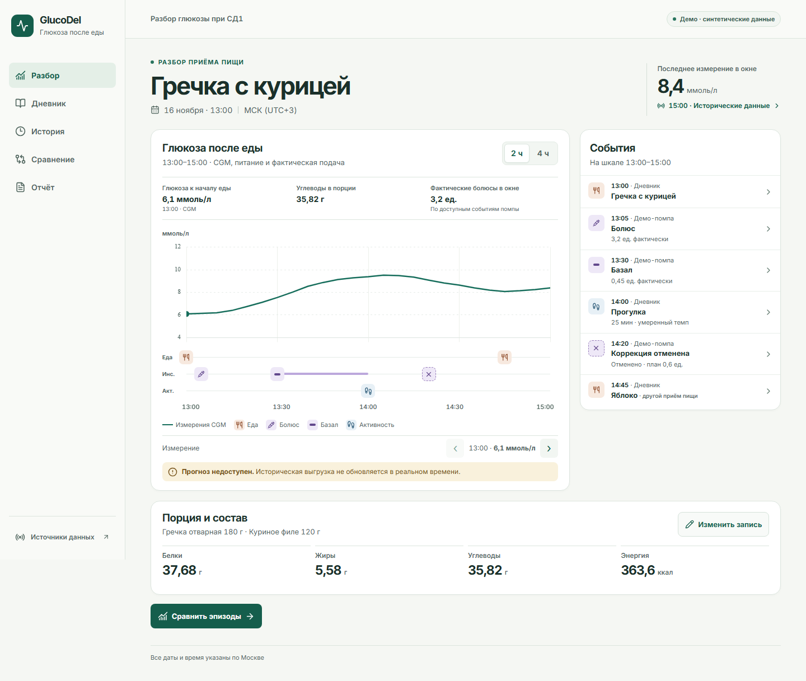

# GlucoDel

**Разбор глюкозы после еды для людей с диабетом 1 типа.**

После обеда глюкоза пошла вверх. Через пару часов уже трудно вспомнить, сколько было углеводов, когда помпа подала болюс и была ли после еды прогулка. График сенсора показывает динамику, но остальные детали приходится искать в разных местах.

GlucoDel собирает контекст приёма пищи на общей шкале. Вы видите показания CGM, состав и размер порции, фактическую подачу инсулина и события вроде прогулки или перекуса. Два похожих приёма пищи можно сравнить от начала еды и посмотреть, чем отличались исходная глюкоза, подача и обстоятельства.

[Открыть демо GlucoDel](https://shneiderman02.github.io/posle-edy/)

## Что можно попробовать

В демо уже открыт вымышленный обед. Посмотрите, как менялась глюкоза, откройте события помпы и сравните обед с такой же порцией в другой день. Дневник позволяет уточнить состав и массу продуктов. Историю за выбранный период можно сохранить в PDF, чтобы иметь её под рукой, например к визиту к врачу.

[Сравнение эпизодов](docs/screenshots/compare-1440.png) · [Разбор на телефоне](docs/screenshots/analysis-390.png) · [Сравнение на телефоне](docs/screenshots/compare-390.png)

## Где проект сейчас

Публичная версия — интерактивное демо с вымышленными данными. В локальной версии можно получать историю из Nightscout или загружать её по шаблонам CSV и сопоставлять с записями о еде. Записи о болюсах из Nightscout видны отдельно от подтверждённой подачи. Следующий шаг — сверить синхронизацию на источнике участника и пройти сценарий разбора вместе с людьми с СД1.

GlucoDel показывает историю и контекст. Для текущих решений о лечении используйте свой план ведения диабета и штатные приложения устройств.

[Запуск, Nightscout и CSV](docs/development.md) · [Границы прототипа](docs/prototype-scope.md)
